# ambientCG: Corrugated Steel materials

**15 assets from [ambientCG](https://ambientcg.com), dedicated to the public domain under [CC0](https://docs.ambientcg.com/license/).** Use them in any game, free or paid, and change them however you like; no credit is needed.

PBR materials as 1K and 2K JPG maps (colour, normal GL and DX, roughness, AO, displacement), one folder per resolution. 385.9 MB in all.

This is a copy kept by [zuujis-cc0](https://github.com/zuujis-cc0) so game makers can take single files from GitHub. It is not made by or affiliated with ambientCG: the originals, often in more formats and higher resolutions, are on [ambientcg.com](https://ambientcg.com). If they help you, consider [supporting ambientCG](https://www.patreon.com/ambientCG).

Every file is listed in [MANIFEST.tsv](MANIFEST.tsv) with its size and SHA-256. More free assets: [the Zuujis collection](https://github.com/zuujis-cc0/free-game-assets#readme).

| | | | |
| :-: | :-: | :-: | :-: |
| <a href="CorrugatedSteel001">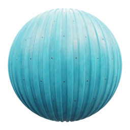</a> <b><a href="CorrugatedSteel001">Corrugated Steel 001</a></b> by ambientCG · <a href="https://ambientcg.com/a/CorrugatedSteel001">source</a> | <a href="CorrugatedSteel002">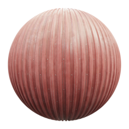</a> <b><a href="CorrugatedSteel002">Corrugated Steel 002</a></b> by ambientCG · <a href="https://ambientcg.com/a/CorrugatedSteel002">source</a> | <a href="CorrugatedSteel003">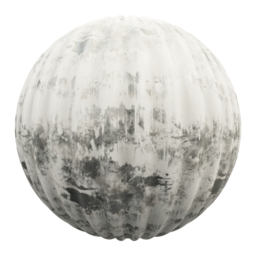</a> <b><a href="CorrugatedSteel003">Corrugated Steel 003</a></b> by ambientCG · <a href="https://ambientcg.com/a/CorrugatedSteel003">source</a> | <a href="CorrugatedSteel004">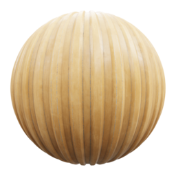</a> <b><a href="CorrugatedSteel004">Corrugated Steel 004</a></b> by ambientCG · <a href="https://ambientcg.com/a/CorrugatedSteel004">source</a> |
| <a href="CorrugatedSteel005">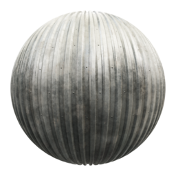</a> <b><a href="CorrugatedSteel005">Corrugated Steel 005</a></b> by ambientCG · <a href="https://ambientcg.com/a/CorrugatedSteel005">source</a> | <a href="CorrugatedSteel006A">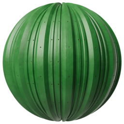</a> <b><a href="CorrugatedSteel006A">Corrugated Steel 006 A</a></b> by ambientCG · <a href="https://ambientcg.com/a/CorrugatedSteel006A">source</a> | <a href="CorrugatedSteel006B">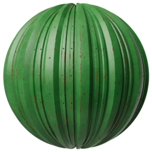</a> <b><a href="CorrugatedSteel006B">Corrugated Steel 006 B</a></b> by ambientCG · <a href="https://ambientcg.com/a/CorrugatedSteel006B">source</a> | <a href="CorrugatedSteel006C">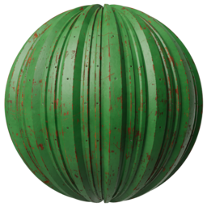</a> <b><a href="CorrugatedSteel006C">Corrugated Steel 006 C</a></b> by ambientCG · <a href="https://ambientcg.com/a/CorrugatedSteel006C">source</a> |
| <a href="CorrugatedSteel007A">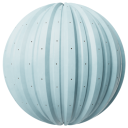</a> <b><a href="CorrugatedSteel007A">Corrugated Steel 007 A</a></b> by ambientCG · <a href="https://ambientcg.com/a/CorrugatedSteel007A">source</a> | <a href="CorrugatedSteel007B">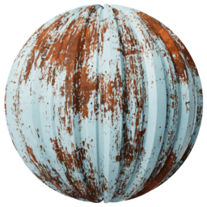</a> <b><a href="CorrugatedSteel007B">Corrugated Steel 007 B</a></b> by ambientCG · <a href="https://ambientcg.com/a/CorrugatedSteel007B">source</a> | <a href="CorrugatedSteel007C">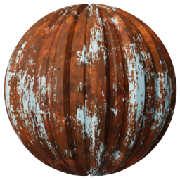</a> <b><a href="CorrugatedSteel007C">Corrugated Steel 007 C</a></b> by ambientCG · <a href="https://ambientcg.com/a/CorrugatedSteel007C">source</a> | <a href="CorrugatedSteel008A">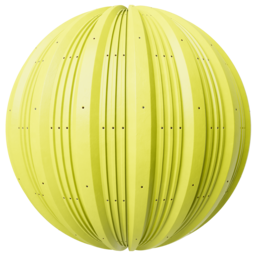</a> <b><a href="CorrugatedSteel008A">Corrugated Steel 008 A</a></b> by ambientCG · <a href="https://ambientcg.com/a/CorrugatedSteel008A">source</a> |
|  <b><a href="CorrugatedSteel008B">Corrugated Steel 008 B</a></b> by ambientCG · <a href="https://ambientcg.com/a/CorrugatedSteel008B">source</a> | <a href="CorrugatedSteel008C">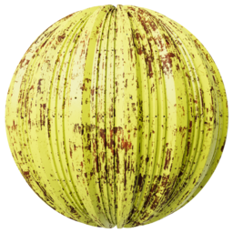</a> <b><a href="CorrugatedSteel008C">Corrugated Steel 008 C</a></b> by ambientCG · <a href="https://ambientcg.com/a/CorrugatedSteel008C">source</a> | <a href="CorrugatedSteel009">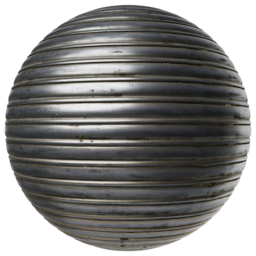</a> <b><a href="CorrugatedSteel009">Corrugated Steel 009</a></b> by ambientCG · <a href="https://ambientcg.com/a/CorrugatedSteel009">source</a> |  |

---

Kept up to date by this repository's own [update workflow](.github/workflows/update.yml), with code and plan from [cc0-mirror](https://github.com/zuujis-cc0/cc0-mirror). Something wrong? [Open an issue there](https://github.com/zuujis-cc0/cc0-mirror/issues/new) or use the [private report form](https://games.zuujis.com/report).
